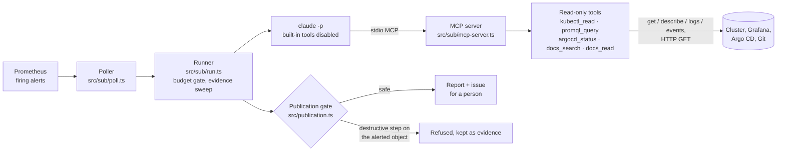

# Read-only Incident Agent

**Investigates cluster alerts without changing the cluster.**

A firing Prometheus alert goes in; a ranked triage report comes out, filed as an
issue for a person to act on. In between, Claude investigates through five
read-only tools: Kubernetes reads, PromQL, Argo CD status and runbook search.
The agent cannot change the cluster, and the tests in this repository show
which parts of the code make that true.

This is a curated public copy of a private repository, maintained by Mark Lee
([leemark.dev](https://leemark.dev)). Infrastructure names, hosts and addresses
are placeholders.

## Why

Overnight alerts on a small k3s cluster arrive with no one awake to look. The
first hour of most incidents is the same reading: which pods, which logs, which
metrics, which runbook. This agent does that reading and leaves the decision to
a person. The constraint shaped every design choice: an agent that can act on
a cluster at 03:00 is an outage generator, so it holds no write credentials and
its tool layer has no way to express a write.

## Architecture



The same tool layer also serves an API mode (the Anthropic SDK tool runner) and
a local-model evaluation bench. See [docs/architecture.md](docs/architecture.md).

## What's inside

| Path | What it is |
|---|---|
| `src/tools/` | The five read-only tools and their strict input schemas |
| `src/sub/` | Subscription mode: `claude -p` runner, stdio MCP server, poller, budget ledger, redaction, issue filing |
| `src/publication.ts`, `src/mutations.ts` | The gate that refuses reports recommending destructive steps on the alerted object |
| `src/sweep.ts` | A fixed read-only evidence sweep run before the model's first turn |
| `src/grade.ts`, `src/scenario.ts` | The mechanical grader and scenario loader |
| `src/index.ts`, `src/triage.ts`, `src/localWire.ts`, `src/egress.ts` | API mode and the local-model bench with its egress guard |
| `scenarios/` | Two frozen incidents, each with a rubric and known-good and known-bad reports |
| `scripts/` | Replay, grade, RBAC audit of the agent's identity, link check |
| `tools/` | Shell entry points for a scheduler: one triage, one poll, issue filing, RBAC audit |
| `test/` | Offline tests of the read-only boundary and the grader |
| `docs/` | Architecture, safety model, evaluation method and results |

## Run and verify

Requires Node 22 or later. Install dependencies with `npm ci`.

```sh
npm test               # offline: 70 tests, no cluster, network or model
npm run typecheck      # tsc over src/, scripts/ and test/
npm run check:links    # relative links in the Markdown
shellcheck tools/*
npm run grade -- --scenario prometheus-wal-eio --known-good   # offline grading
```

Running the agent itself needs a cluster and credentials: copy `.env.example` to
`.env` and fill it in. Then:

```sh
tools/sub-triage --alert scenarios/watchdog-heartbeat-backoff/alert.json   # one triage via claude -p
tools/sub-poll                                                             # what a scheduler runs
npm run replay -- --scenario prometheus-wal-eio --dry-run                  # recorded turns, real read-only cluster reads
npm run audit:rbac                                                         # audit the kubeconfig's permissions
```

## Safety: what the tests prove

The offline tests in `test/` check each of these:

- **No write verb is reachable through `kubectl_read`.** Its `subcommand` is a
  closed enum of `get`, `describe`, `logs` and `events`; `apply`, `delete`,
  `patch`, `scale`, `exec` and the rest of kubectl's write verbs fail schema
  validation. Unknown keys are rejected, so there is no raw-argument escape
  hatch, and field values cannot smuggle flags. An exhaustive sweep renders
  every valid combination of fields (over a thousand argv) and finds none that
  starts with anything but a read verb or carries a flag outside a fixed set.
- **Secrets and cluster-scoped kinds cannot be requested**, template and
  file-backed output formats are unrepresentable, and logs always carry a tail
  bound.
- **The Grafana datasource proxy path cannot be escaped** by a crafted UID.
- **`claude -p` is started with every built-in tool disabled** (`--restricted`,
  `--tools ""` and a by-name deny list), only this server's tools pre-approved
  by explicit name, `--permission-mode dontAsk`, `--strict-mcp-config`, no
  setting sources and a per-run spend cap. The deny list is checked against an
  independent inventory of the built-in tools in every pinned CLI version, and
  an unreviewed version is not pinned.
- **The child environment is an allowlist**: API keys, provider routing and
  cloud credentials are dropped before `claude` starts.
- **Known secrets are redacted** in raw, URL-encoded and base64 forms, as are
  `Authorization` header echoes.
- **A report recommending deletion of the alerted Job is refused publication**;
  one recommending only reads is published.
- **The RBAC audit's evaluator** fails a listing with any verb beyond `get`,
  `list` and `watch`, any wildcard resource, or any proxy, exec, attach or
  port-forward subresource. Its
  only exceptions are `create` on the self-review resources and a `get`-only
  service-proxy grant for the sealed-secrets controller, by name, in that
  controller's namespace. An unparseable listing is never a pass.
- **The issue destination has no defaults** and must be a bare https origin and
  an `owner/name` repository.

Not covered by tests, but checked by reading the code: the cluster-facing HTTP
tools (`promql_query`, `argocd_status`, `docs_search`, `docs_read`) only issue
`GET` requests, and kubectl is spawned only with the argv the schema renders.
Whether a given kubeconfig is actually read-only is a property of the cluster:
`npm run audit:rbac` checks a live identity with the rules above. Subscription
mode's read-only property depends on Claude Code's command-line flags, which is
why the runner refuses unreviewed CLI versions. That and the other residual
risks are in [docs/safety-model.md](docs/safety-model.md).

## Design decisions

- **Typed tools, not a shell.** The model fills in fields; the harness renders
  the command. A write is not forbidden, it is inexpressible.
- **Defence in depth that does not share a failure mode.** The tool schema,
  cluster RBAC and the CLI belt each hold read-only on their own.
- **Read-only is not enough.** A read-only agent can still recommend deleting
  the evidence, so the publication gate reads the report's commands before
  anything is filed. See [docs/safety-model.md](docs/safety-model.md).
- **Empty results are not health.** `promql_query` measures ingestion freshness
  and prefixes every result with a verdict, because "no series" during a
  monitoring outage looks exactly like "no problem".
- **A mechanical grader.** Reports are scored by regular expressions against
  committed rubrics and the run's own tool transcripts, never by another model.
  See [docs/evaluation.md](docs/evaluation.md).
- **Subscription mode for the live path.** The poller drives Claude through the
  `claude -p` CLI on a fixed plan, with a monthly budget ledger, instead of
  metered API calls.

## Layout

```
src/            agent, tools, grader, subscription mode (src/sub/)
scenarios/      frozen incidents with rubrics and reference reports
scripts/        replay, grade, RBAC audit, link check
tools/          shell entry points for a scheduler
test/           offline node:test suites
docs/           architecture, safety model, evaluation
```

## Status

Running. The live poller first triaged alerts overnight on a single-operator
k3s cluster in September 2026, has run again since October 2026, and has filed
its reports as issues since 19 October 2026. A local-model engine was evaluated
as an autonomous investigator and did not pass; it remains as a bench
([docs/evaluation.md](docs/evaluation.md)).

Limits worth knowing: it has run on one cluster; only two of its scenarios are
published; the RBAC audit and the subscription belt are verified offline and by
audit, not by an adversarial probe of the live CLI; and a passing grade is a
floor, not proof of a good report.

## License

[MIT](LICENSE)
