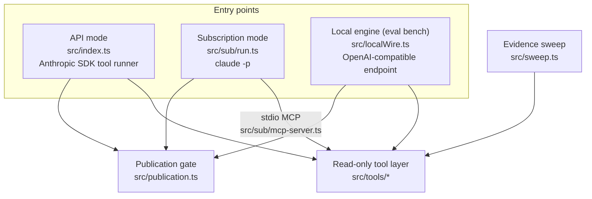
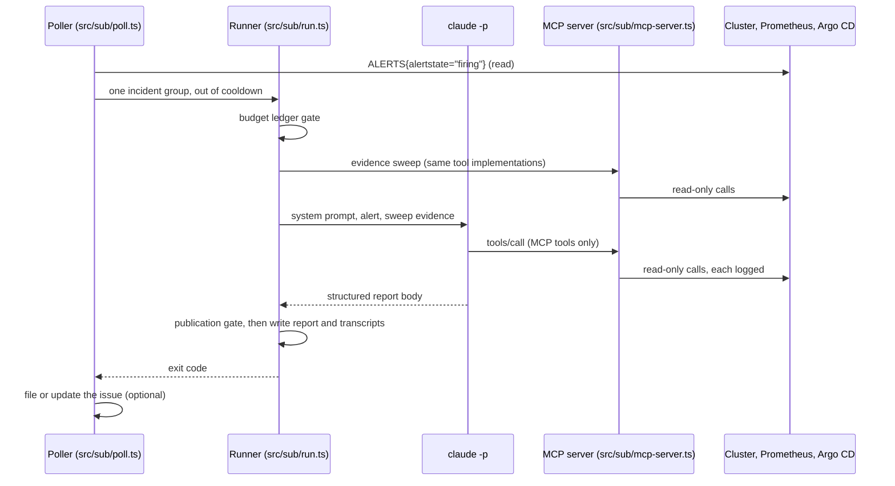

# Architecture

The agent turns one firing alert into one triage report. It reads the cluster,
it never changes it, and a person decides what happens next.

## Three engines over one tool layer

All three entry points share the same five tools, the same system prompt, the
same evidence sweep, the same report writer and the same publication gate. They
differ only in who drives the tool loop.

| Entry point | Drives the loop | Used for |
|---|---|---|
| Subscription mode (`src/sub/run.ts`) | Claude, through `claude -p` with every built-in tool disabled and a local MCP server exposing the five tools | The live overnight poller |
| API mode (`src/index.ts`, `src/triage.ts`) | Claude, through the Anthropic SDK tool runner (`betaZodTool`). No shell or file tool exists to fence off | Reference path; needs an API key |
| Local engine (`src/localWire.ts`, `src/transport.ts`) | A local model behind an OpenAI-compatible endpoint (Ollama, LM Studio); every outbound connection must land on a local address (`src/egress.ts`) | The evaluation bench |

A fourth transport, the **recorded** transport, replays hand-written assistant
turns from a scenario's `replay.json` through the same loop. It exercises the
harness and the grader without any model ([evaluation.md](evaluation.md)).

## The tools

| Tool | File | Reads |
|---|---|---|
| `kubectl_read` | `src/tools/kubectl.ts` | `get`, `describe`, `logs`, `events` in one namespace, built from typed fields |
| `promql_query` | `src/tools/promql.ts` | PromQL through Grafana's datasource proxy, prefixed with a measured ingestion-freshness verdict |
| `argocd_status` | `src/tools/argocd.ts` | Argo CD application sync and health |
| `docs_search`, `docs_read` | `src/tools/docs.ts`, `src/docs/*` | Runbooks and ADRs from the `docs/` trees of the platform's Git repositories, pinned to a commit |

Each tool is optional except `kubectl_read`: a tool whose endpoint is not
configured is left out of the model's tool list, and the prompt says which
evidence is unavailable.

## One run, in subscription mode

1. **Poll.** `src/sub/poll.ts` reads `ALERTS{alertstate="firing"}` through the
   same vetted Prometheus path the tool uses, groups series into incidents by
   `alertname|namespace|subject`, and starts at most `SRE_SUB_MAX_RUNS_PER_POLL`
   runs, each group at most once per cooldown (24 hours by default), only inside
   `SRE_SUB_POLL_HOURS`.
2. **Budget gate.** `src/sub/budget.ts` keeps a monthly ledger from Claude Code's
   `total_cost_usd`: a warning at 80 percent, a refusal at 100 percent, and a
   per-run ceiling passed as `--max-budget-usd`. Refusals are ledger entries too.
3. **Evidence sweep.** Before the model's first turn, `src/sweep.ts` collects a
   fixed read-only evidence set for the alert's class, through the same tool
   implementations the model is handed, so there is no second path to the
   cluster.
4. **Investigation.** `claude -p` runs with the belt described in
   [safety-model.md](safety-model.md); the only tools it can call are the five
   above, served by `src/sub/mcp-server.ts`, a small hand-written stdio JSON-RPC
   server that validates every call against the tool's schema and logs it.
5. **Publication gate.** `src/publication.ts` scans the report's recommended
   commands. A destructive command aimed at the alert's own object refuses
   publication (exit 7); the report and transcripts are kept as evidence beside
   a `.rejected.json` marker.
6. **Issue.** With `SRE_SUB_ISSUES=live`, `src/sub/issues.ts` files the published
   report as an issue (or comments on the open one for the same group) in the
   repository named by `SRE_SUB_ISSUE_*`, with a bot token fetched after the
   model has exited.

## What a run leaves behind

`reports/sub/<stamp>--<alert>/` (gitignored):

- `triage-<date>.md`: the report, with a header naming the engine and a footer
  carrying turns, cost, tool-call counts and the evidence-sweep table;
- `.tools.json`, `.queries.json`, `.retrieval.json`: transcripts of what each
  tool returned, which the grader uses to verify evidence and citations;
- `.claude.json`: Claude Code's raw result, including `permission_denials`;
- `calls.jsonl`, the composed prompts and the MCP config, for provenance.

These files contain operational data and model output. They are run artefacts,
kept locally under a retention policy, and never committed.

## Exit codes

| Code | Meaning |
|---|---|
| 0 | Report written |
| 2 | Configuration error |
| 3 | Monthly budget ceiling reached |
| 4 | `claude` is not logged in |
| 5 | Run failed |
| 6 | The plan's usage window is exhausted; the poller stops for this poll |
| 7 | Publication rejected by the safety gate; evidence retained |
| 8 | (poller) Report published, but its issue was not filed |

## Report shape

Triage reports have five required sections, in order: Symptom, Evidence,
Probable cause (ranked), Suggested runbook and Confidence. A post-mortem mode
(`src/postmortem.ts`) drafts a nine-section incident write-up with the same
tools.
